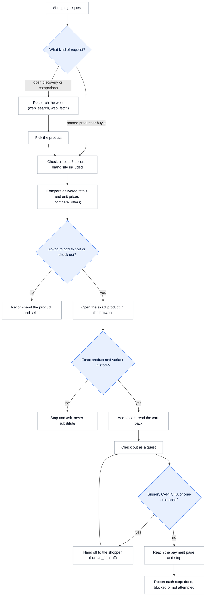

<h1 align="center">Benji</h1>

<p align="center">
  <picture>
    <source media="(prefers-color-scheme: dark)" srcset="public/brand/logo-reversed.svg">
    
  </picture>
</p>

Benji is a personal shopping agent from The Prompting Company, built on
[Eve](https://eve.dev/docs). Give it a purchase, a budget and a postcode. It compares
sellers on the delivered total, checks the merchant's own page, and takes the item as far
as the payment page.

[](https://vercel.com/new/clone?repository-url=https%3A%2F%2Fgithub.com%2Fpromptingcompany%2Fdealfinder&env=OPENAI_API_KEY,BROWSERBASE_API_KEY,BENJI_OPERATOR_USERNAME,BENJI_OPERATOR_PASSWORD&envDescription=An+OpenAI+key+for+the+model,+a+Browserbase+key+for+the+hosted+browser,+and+the+username+and+password+%28at+least+32+characters%29+that+protect+your+deployment.&envLink=https%3A%2F%2Fgithub.com%2Fpromptingcompany%2Fdealfinder%23keys&project-name=benji&repository-name=benji)

It follows rules drawn from a study of how personal agents shop on live stores:

- Choose the product and the seller separately, and compare sellers on what you pay to
  receive the item: price, shipping and tax.
- Report unit price next to pack size, and do not upsize a one-item request.
- Treat stock as a fact. A low-stock label breaks a tie and nothing more.
- Keep the exact product and variant the shopper named. Stop and ask before any swap.
- Research first, then ask once for whatever is still missing.
- Report each checkout step as done, blocked, or not attempted.

## How it works



The rules live in [`agent/skills/shopping-research/SKILL.md`](agent/skills/shopping-research/SKILL.md)
and [`agent/instructions.md`](agent/instructions.md). Every step runs as an Eve workflow step, so a
conversation can pause for the shopper at a handoff and pick up where it stopped.

## Keys

Two keys run the full agent. Everything else is optional and off by default.

| Variable | Needed | What it does | Where to get it |
| --- | --- | --- | --- |
| `OPENAI_API_KEY` | Always | Runs the model (`gpt-5.6-sol` by default). | [platform.openai.com/api-keys](https://platform.openai.com/api-keys) |
| `BROWSERBASE_API_KEY` | For hosted browsers | Opens the store pages in a hosted browser. | [browserbase.com](https://www.browserbase.com) |
| `PARALLEL_API_KEY` | Optional | Adds public web search before the browser opens a page. | [parallel.ai](https://parallel.ai) |

To try it with one key, set `STAGEHAND_BROWSER=local`. Benji then drives Chrome on
your machine and needs only `OPENAI_API_KEY`. Some stores block a local browser sooner
than a hosted one.

| Setting | Default | Change it when |
| --- | --- | --- |
| `STAGEHAND_BROWSER` | `browserbase` | Set `local` to use your own Chrome. |
| `BENJI_MODEL` | `gpt-5.6-sol` | Your OpenAI account uses a different model. |
| `BENJI_BROWSERBASE_PROXIES` | off | Set `1` for Browserbase managed proxies. Needs a paid Browserbase plan. |
| `BENJI_BROWSERBASE_VERIFIED` | off | Set `1` for Browserbase Verified Browsers. Needs the Enterprise plan. |
| `BENJI_OPERATOR_USERNAME`, `BENJI_OPERATOR_PASSWORD` | unset | You expose the app beyond your own machine. The password must be at least 32 bytes. |

[`.env.example`](.env.example) lists every variable.

## Deploy

Click **Deploy with Vercel** above. Vercel copies the repository to your GitHub account
and asks for four values:

| Variable | What to enter |
| --- | --- |
| `OPENAI_API_KEY` | Your OpenAI key. |
| `BROWSERBASE_API_KEY` | Your Browserbase key. The free plan works. |
| `BENJI_OPERATOR_USERNAME` | A username for signing in to your deployment. |
| `BENJI_OPERATOR_PASSWORD` | A password of at least 32 characters. |

Open the deployment, sign in with that username and password, and give it a task. To run
it against your own store, name the store in the task, for example "Buy the black 24 oz
bottle from yourstore.com and stop at the payment page."

## Run locally

You need Node.js 24, Bun 1.4.4, Chrome, and a running Docker daemon for Eve's local
sandbox. Benji needs no database.

```sh
bun install
cp .env.example .env.local
# Fill in OPENAI_API_KEY and BROWSERBASE_API_KEY, or set STAGEHAND_BROWSER=local.
bun run dev
```

Open http://127.0.0.1:4320. The first start compiles the agent, and the first
conversation can take a few minutes while Eve prepares its sandbox.

- `bun run dev` starts Eve on port 4321 and Next.js on port 4320, and stops both together.
  Use it instead of `next dev` so conversations resume after a restart.
- Restart after you change environment variables, instructions, skills, or tools.
- If `.env.local` holds 1Password references, run
  `op run --env-file=.env.local -- bun run dev`.
- The app allows one trusted operator on your own machine. Set operator sign-in and
  durable storage before you share a deployment. See
  [browser runtime](docs/browser-runtime.md).

## Try a task

> Find three noise-cancelling headphones for long flights under USD 300, delivered
> to California. Compare comfort, battery life, exact variants, current offers,
> returns, and total cost. Recommend one and explain what you could not verify.

Asked to buy, Benji goes as far as the payment page as a guest. It asks for a name,
email and address instead of inventing them. The `compare_offers` tool does the totals, so
an offer with unknown shipping or tax is never ranked as cheapest.

The starter buttons fill an editable brief; they do not start a run. Budget and
delivery fields are sent as context on each turn. New research resets the prior
conversation and releases its browser. Each `/s/<sessionId>` URL resumes that
conversation; it is a local operator URL, not a public share link. Export contains
visible messages, not tool events or screenshots.

## Results

On five shopping tasks on live stores, Benji reached the payment page in 4 of 5 with
the hosted browser. See [results](docs/results.md) for every task and the stock test.

## Test stores

Benji is tested on real retailers and on two purpose-built stores where one detail
changes at a time. See [test stores](docs/test-stores.md) for the stores, the tests and
the results so far.

## Customize

| File | Purpose |
| --- | --- |
| `agent/instructions.md` | Identity and tool protocols |
| `agent/skills/shopping-research/SKILL.md` | Shopping brief, research, comparison, and evidence procedure |
| `agent/tools/compare_offers.ts` | Delivered totals, unit prices, and budget fit from observed prices |
| `agent/agent.ts` | Model, session limits, and runtime dependencies |
| `app/chat.tsx` | Shopping brief, conversation, browser capture, and export |
| `agent/tools/` | Research and browser tools |
| `server/browser/` | Browser lifecycle, contexts, credentials, and handoff |

## Checks

```sh
bun run test       # Vitest suite; provider-backed checks are opt-in.
bun run typecheck
bun run lint
bun run build     # Eve bundle, Stagehand assets, and Next.js production build.
```

See [provider checks](docs/provider-tests.md) for explicit live checks.

## Credits

Benji's browser runtime and integrations are adapted from
[Browserbase BELL](https://github.com/browserbase/bell-stack) under the MIT licence. See
[UPSTREAM.md](UPSTREAM.md) and [LICENSE](LICENSE).
